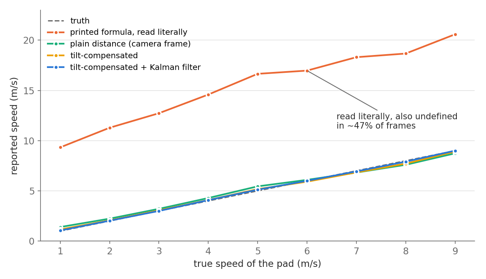
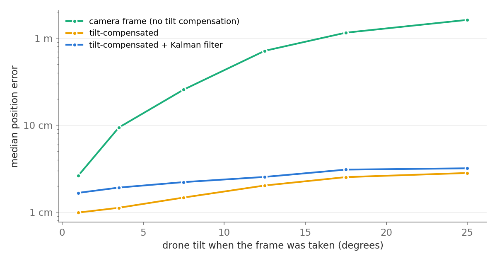

import LandingReplay from "../../components/LandingReplay.astro";

Hi Guys, back in 2019 at the University of Peradeniya, Rajitha Rajasooriya, Kavin Ranawella, Dr. Namal Karunarathne and I wrote a paper called *Landing a Quadcopter on to a moving landing target using Computer Vision*. I reread it recently and wanted to see how the idea holds up with seven more years of experience and today's tools. So I rebuilt the whole thing in **ROS 2**, wrote a simulator to test it, refined the estimation maths for closed-loop flight and measured the difference. In this post I'll go through why we wrote the paper, how the ROS 2 version works, what I changed, and what the simulation says. There's an interactive replay in the middle so you can watch it land.

All the code is open source at [deBilla/moving-target-landing-ros2](https://github.com/deBilla/moving-target-landing-ros2): the ROS 2 package, the simulator, the experiments and the tests.

## Why we wrote the paper

Landing a quadcopter on the ground is easy. Landing it on a **moving** vehicle is not. The drone has to find the target, work out how fast it's moving and in which direction, cope with wind, and still touch down on a small pad.

A lot of earlier work solved this by letting the drone and the vehicle talk to each other, for example by sending the vehicle's GPS position over a radio link. In the real world you can't always count on that link. So the idea of the paper was to use only what the drone carries:

- one downward-facing camera
- cheap hardware (a Raspberry Pi for the vision and an Arduino Nano for flight control)
- a landing pad with **three ArUco markers of different sizes**

The three markers are the clever part. A big marker is readable from high up, a medium one for most of the flight, and a small one when the drone is almost on the pad. That way there is always one marker fully in view.

The plan in the paper has four steps: design the pad, detect the markers, track the target, and land. For the landing, the drone gets close to the pad, cuts its rotors and drops onto it. If the drop would miss, it aborts and climbs again. In 2019 we built the detection and speed measurement on real hardware and checked the speeds against a phone speedometer on the vehicle. A smooth landing was still future work at the time, and that's the part this rebuild focuses on.

## What OpenCV gives you

OpenCV's ArUco module finds the markers and solves for their pose. For each frame you get two vectors:

- `tvec = (tx, ty, tz)`, the position of the marker in the **camera's** coordinate frame, in metres
- `rvec`, the marker's rotation as an axis-angle vector

Section III-C of the paper builds the relative distance, speed, direction and altitude from these two vectors.

## Refining the maths for closed-loop flight

When you write code to actually fly the drone, every formula has to be exact, so I went through Section III-C line by line. Here's how I implemented each quantity in the rebuild.

| Quantity | In the paper | In the rebuild | Why |
| --- | --- | --- | --- |
| Rotation | `rvecs` | `R = cv2.Rodrigues(rvec)` | `solvePnP` returns `rvec` directly; converting it to a matrix lets us use it for tilt correction |
| Distance moved | `√((tx₁² + ty₁²) − (tx₂² + ty₂²))` | `‖p₂ − p₁‖` in a level world frame | Plain straight-line distance between two positions |
| Speed | `distance / duration` | A Kalman filter on the pad's position | Smooths camera noise between frames |
| Direction | `angle = tyᵢ / txᵢ` | `atan2(vy, vx)` from the filtered velocity | Gives the heading of the motion in all four quadrants |
| Altitude | `tz` | `tvec` rotated by the drone's attitude | Stays correct when the drone tilts |

The distance formula is a good example of why exact notation matters. Written as printed, it subtracts two squared distances from the camera's centre line, which isn't the same thing as the straight-line distance the pad moved. If you code it literally, it goes negative (so the square root is undefined) whenever the pad moves away from the centre of the image. In our 2019 experiment the system's speeds were close to the phone's readings, which tells me the code we ran computed a plain distance and the slip was only in how the formula was typeset. In the rebuild I use the straight-line distance:

```python
d = np.linalg.norm(p2[:2] - p1[:2])   # p1, p2 are pad positions in the world frame
```

The altitude change matters most once the drone is flying itself. A quadcopter has to **tilt** to move sideways, and the camera is bolted to the frame, so it tilts too. At 4 m up, a 20° tilt makes the pad look about 1.5 m away from where it really is. That doesn't come up when you're measuring speed, but it does as soon as the drone has to chase the pad. The answer is to rotate the camera measurement by the drone's attitude (which the flight controller already knows) before using it. This is the core of the estimator in the rebuild:

```python
# Camera axes in the body frame (FLU), for a camera looking straight down
R_BODY_CAM = np.array([[0, -1, 0], [-1, 0, 0], [0, 0, -1]])

def pad_position_in_world(tvec, drone_pos, R_world_body, cam_offset):
    """Where the pad really is, given one camera measurement and the drone's pose."""
    p_rel_body = R_BODY_CAM @ tvec + cam_offset
    return drone_pos + R_world_body @ p_rel_body
```

The pad's world position then goes into a constant-velocity Kalman filter. Its velocity estimate gives the pad's speed and direction, and the relative velocity is just `v_pad − v_drone`.

## Rebuilding it in ROS 2

I split the system into ROS 2 (Jazzy) nodes, one per job:

```text
 sim_world ──camera image──▶ aruco_detector ──pad pose──▶ target_estimator
     ▲   └────────── drone state (attitude, velocity) ───────▶      │
     │                                                              ▼
     └──────── velocity command, motor cut ◀──────── landing_controller
```

- **sim_world** simulates the drone, the vehicle and the wind, and **renders the downward camera image**. It doesn't use Gazebo. The scene is just three flat textured planes (ground, vehicle deck and pad), so each frame is three perspective warps in OpenCV. That's enough to give the real ArUco detector real images, with tilt, noise, blur and background clutter.
- **aruco_detector** finds the markers and estimates the pad's pose, using all visible markers together.
- **target_estimator** runs four variants side by side on every detection, so I can see what each step adds: the formulas **as printed**, taken literally; the same idea with a **plain distance** but still in the camera frame; a **tilt-compensated** version; and the full **filtered** version with the Kalman filter. A parameter picks which one actually flies the drone.
- **landing_controller** is a state machine: SEARCH, TRACK, DESCEND, FINAL, CUT, LANDED, plus ABORT. In FINAL it hovers just above the pad and only cuts the motors when the predicted drop point is within 12 cm of the pad centre. That's the paper's projectile idea with a safety check.

Everything runs headless in Docker, so it works on a Mac without a GPU.

## Watch it land

These are recordings of the full ROS 2 graph. Pick a run and press Play. The top view follows the vehicle, the camera panel shows what the drone sees, and the colour band under the height plot shows the landing phase. The bottom-right panel compares a literal reading of the printed speed formula with the filtered estimate on the same run.

<LandingReplay src="/replays/quadcopter-landing" />

The filtered version lands on the stationary pad and on the pad moving at 2 m/s, about 10 cm from the centre. Flying on the camera-frame numbers alone, the drone loses the pad within a few seconds: it tilts to catch up, the tilt shifts where it thinks the pad is, and it drifts away. The weave run shows the filtered version struggling too. I'll come back to that.

## Experiment 1: measuring the pad's speed

This repeats the paper's Table I experiment. The drone hovers 3.5 m above the deck and the vehicle drives underneath at 1 to 9 m/s. Every variant sees exactly the same camera images.



Coded literally, the printed distance formula reads 9 to 21 m/s for a pad doing 1 to 9 m/s, and it's undefined in about 47% of frames. That's a good reminder of how much one typeset formula can change the result if someone implements it straight from the paper. With a plain distance the speeds are right on average. The filtered version stays within 0.07 to 0.14 m/s of the truth at every speed. The two unfiltered versions are noisier, with errors around 0.5 to 1 m/s, because they divide frame-to-frame differences by 33 ms.

## Experiment 2: what tilt does

Next I took the 28 flights flown by the filtered estimator (7 vehicle motions, 4 random seeds each, about 22,000 detections) and compared every variant's idea of where the pad is with the true position, grouped by how much the drone was tilted when the frame was taken. All four variants saw the same frames.



When the drone is level, the camera-frame position is fine (about 3 cm off). At 10 to 15° of tilt it's 70 cm off, and above 20° it's over 1.5 m off. Rotating by the attitude keeps it between 1 and 3 cm at any tilt. The same goes for altitude: using `tz` directly was off by 11 cm on average in flight, against 2 cm after the rotation.

The filtered position is about a centimetre worse than the raw compensated one, because the filter smooths and lags slightly. In return its speed error is half as big (0.07 m/s against 0.15 m/s), and the speed is what the drop decision depends on.

## Experiment 3: does it actually land?

Each variant flew the drone in 7 scenarios (stationary, straight at 2 m/s, accelerating, a circle, a lane-change weave, stop-and-go traffic and a fast 4.5 m/s run) with 4 random seeds each. A run counts as a landing only if the drone ends up on the pad, within 35 cm of the centre, hitting at under 2.2 m/s.

| Variant flying the drone | Landings | What happened otherwise |
| --- | --- | --- |
| Camera frame, printed formulas | 0 / 28 | Lost the pad once the drone tilted |
| Camera frame, plain distance | 0 / 28 | Lost the pad once the drone tilted |
| Tilt-compensated | 6 / 28 | Mostly timed out after aborting |
| Tilt-compensated + Kalman filter | 7 / 28 | Mostly timed out after aborting |

So for closed-loop flight, tilt compensation is the step that makes the difference. When the filtered version landed, it was 4 to 14 cm from the centre on average, so the estimation part works. What doesn't work yet is my **landing controller** on harder motions. It got 3 of 4 on the stationary pad and 2 of 4 on the straight one, but none on the weave, stop-and-go and fast runs. It gets down to the final hover, the pad shifts or brakes, the camera loses it, and it aborts and climbs. That's a control problem, not a vision one, and it's what I'll work on next.

## A lesson about the pad

The three-marker pad does what we wanted. Between 1.2 m and 4 m the pad was detected in 86 to 90% of frames. Below 0.5 m, though, the large and medium markers are almost always cut off and the small one does all the work.

My first try in simulation used a 10 cm centre marker, and the camera lost it in the last 30 cm unless the drone was within 3 cm of the centre. At that height a 70° camera only sees about 42 × 31 cm of the pad. I ended up with 32, 20 and 16 cm markers, and even then the final half second before the drop runs on the Kalman filter's prediction. We pointed out this exact challenge in the paper: when the drone is very close, it can't see the target any more.

## Run it yourself

You only need Docker. Build the image once, then fly a landing through the full ROS 2 graph:

```bash
git clone https://github.com/deBilla/moving-target-landing-ros2.git
cd moving-target-landing-ros2
docker build -f docker/Dockerfile -t mtl_landing:jazzy .
docker/run_ros_sim.sh straight corrected   # scenario, then estimator variant
docker/run_ros_sim.sh straight paper       # same flight with the formulas as printed
```

Each run writes a JSON log and the camera frames into `results/`. The scenarios are `static`, `straight`, `accelerating`, `circle`, `weave`, `stop_go` and `fast`, and the variants are `paper`, `naive`, `compensated` and `corrected`. The README has the commands for the batch experiments and the unit tests.

## Wrapping up

- The **motivation** still holds: landing on a moving vehicle with only a camera, without trusting a radio link. The three-marker pad works as intended.
- Moving from measuring speed to flying the drone in a closed loop needs two additions: **compensating for the camera's tilt** and **filtering** the measurements. Tilt compensation is the one that matters most.
- With those, estimation is accurate to a few centimetres and about 0.1 m/s. Closed-loop landing works on steady targets but still needs a better controller for weaving and braking vehicles.

Next I want to improve the final approach so it copes with vehicles that turn and brake, and then try it on real hardware again.

Happy Coding ;)
